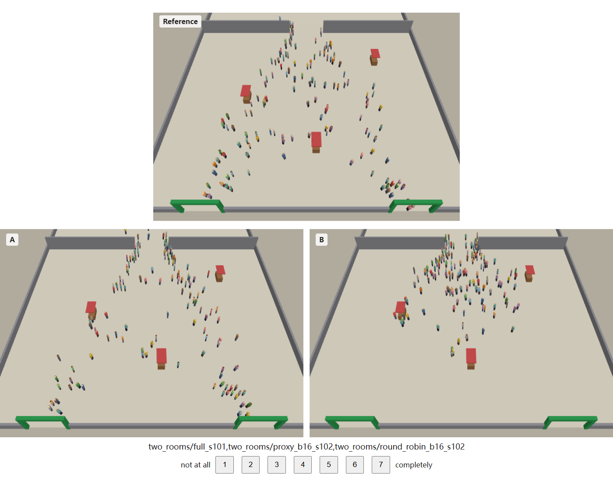

# Perceptual study protocol

Question: under the same cognitive-compute budget, does the crowd produced by our allocator (`proxy`)
look more like the full cognitive simulation than the crowds produced by budget-matched baselines?
The study complements the trajectory metrics: those say how far the simulation drifts, this says
whether viewers notice.

*A Part 1 trial (preview mode, `two_rooms`, 12 s in): top, the full simulation; bottom, `proxy`
and `round_robin` at β = 1/16, both started from a seed different from the top clip.*

## 1. Design

Within-subject, two parts, about 40 minutes, run in the browser (desktop/laptop only).

**Part 1: match to sample (56 trials).** The upper clip is the full simulation (all agents at
L3) with seed *a*. The two lower clips start from the same different seed *b*; the participant
picks the lower clip that "behaves more like the upper one". Seeds differ between top and bottom
so the task cannot be solved by matching individual agents. Only the crowd's way of reacting
can be matched: who notices the fire, when, how fast they leave, and whether groups stay
together. Three trial types:

| type | lower pair | per participant | measures |
|---|---|---|---|
| detection | full vs one method | 4 methods × 4 β (1/16, 1/8, 1/4, 1/2) × 2 scenarios = 32 | H2, budget curve |
| preference | `proxy` vs a baseline, same β | (round robin at 1/8 and 1/4; camera LOD at 1/4 and 1/2; `ng2005_w1` at 1/2) × 2 scenarios × 2 repetitions = 20 | H1 |
| catch | full vs all-L0 | 2 scenarios × 2 = 4 | attention check |

**Why this design (revised after the first pilot).** In the first version, detection and
preference used only β = 1/16 and 1/8. At those budgets the visible crowds of camera LOD,
`ng2005_w1` and round robin at 1/16 do not react to the fire within the clip at all: the alarm
starts off camera, and these allocators do not carry it in. Most trials therefore reduced to
"pick the clip in which people evacuate". The pilot participant was at 100% on every trial
type, which tells us nothing beyond the numerical results.

The revised design asks two sharper questions:
- **Detection as a function of budget.** From which budget on can a viewer no longer tell a
  method from the full simulation?
- **Preference only where both clips react.** The rule: for each baseline, the two lowest
  budgets at which at least 90% of its visible people run in the second half of the clip
  (computed from the stimuli). That gives round robin at 1/8 and 1/4, camera LOD at 1/4 and
  1/2, and `ng2005_w1` at 1/2 only. So the choice is about how people react, not whether they
  do.

**Part 2: plausibility (12 trials).** One clip, "How realistic is the behaviour of this crowd?"
on a 1–7 scale. Conditions: full, `proxy`, `round_robin`, `camera_lod`, `ng2005_w1` (all at
β = 1/16), and all-L0, for each of the 2 scenarios.

**Why β = 1/16 for ratings (revised after pilots 2–4).** The numerical headline is at β = 1/16,
so that is the budget at which plausibility has to be judged. Part 1 cannot show it: at 1/16
detection is at ceiling for every method, `proxy` included, so the large difference (the
baselines' visible crowds do not react, `proxy`'s does) is invisible in accuracy, and preference
avoids that budget on purpose. A single-clip rating has no comparison to make trivial. The
first version rated at β = 1/8, where round robin already reacts and was rated as high as the
full simulation; that told us nothing about the budget the paper is about. Pilots also showed
that at β ≥ 1/4 round robin is hard to tell from `proxy` even for the experimenters; H1 against
round robin is kept as specified, and a null result there will be reported as such.

**Factors.**
- Scenarios: `offscreen_alarm` (the fire starts outside the view and the alarm spreads in) and
  `two_rooms` (the fire is in the back room and people must come through the door).
- Budgets: β = 1/16, 1/8, 1/4, 1/2.
- Methods: `proxy` (ours); `round_robin`; `camera_lod` (visibility LOD); and `ng2005_w1`, our
  reproduction of Niederberger & Gross 2005 with the +1 weight variant, because the original
  starves invisible agents.
- Seeds: 100–105 are reserved for stimuli and are never used to tune anything. Every
  participant gets a different random draw of seeds, left/right sides and trial order. The draw
  is reproducible from the participant ID.

**Clips.** 20 s each (80 ticks at 4 Hz, interpolated to the display rate), long enough to show
a reaction that comes a few seconds late. Each clip starts 2 s
before 10% of the visible agents know about the fire (median over seeds), so every clip
contains the moment the crowd reacts. The camera is fixed at the scenario's view rectangle, and
all clips of a trial play in sync. Each trial can be replayed once, and answers are possible
only after the clip ends.

## 2. Hypotheses (confirmatory)

- **H1.** At the same budget, the `proxy` clip is chosen as closer to the full simulation more
  often than chance against each baseline.
- **H2.** Telling the full simulation apart is harder for `proxy` than for each baseline:
  detection accuracy pooled over the budget ladder is lower for `proxy` (paired, one-sided).
- **H3.** At β = 1/16, `proxy` is rated more plausible than each baseline.

Descriptive (reported, not tested): the detection curve per method, i.e. accuracy at each budget
and the lowest budget whose 95% CI includes 0.5. Also effects by scenario, and response times.

## 3. Participants

- **N = 36** after exclusions (recruit about 40).
- Power simulation (`python scripts/analyze_perception.py --power`), assuming:
  - P(prefer ours) = 0.65;
  - detection accuracy falling with budget, for `proxy` 0.85 → 0.55 and for the baselines
    0.98 → 0.62–0.70 (from 1/16 to 1/2), as in `simulate()`;
  - 10% inattentive participants.
- Resulting power after Holm correction: see the table printed by `--power`; rerun it with the
  pilot estimates before freezing N.

- These effect sizes are assumptions. **Run the pilot first (section 7)** and rerun the power
  simulation with `--p-pref` set to the pilot estimate.
- Inclusion: adults with normal or corrected-to-normal vision, using a desktop or laptop
  screen of at least 1280×720.
- Recruitment: Prolific (about 30 min, paid at the platform's recommended hourly rate) or lab
  volunteers.

## 4. Exclusion

Exclude a participant who gets fewer than 3 of the 4 catch trials right. Full vs all-L0 is easy:
in all-L0 nobody reacts to the fire. Report the number excluded. No other exclusions, and
trials are not trimmed by response time.

## 5. Analysis (`scripts/analyze_perception.py`)

- **Unit of analysis.** Per-participant proportions and means, so trials are not treated as
  independent.
- **H1.** Per participant, the share of preference trials choosing `proxy`, per baseline
  (pooled over scenarios and budgets). One-sided Wilcoxon signed-rank test against 0.5, with
  Holm correction over the 3 baselines.
- **H2.** Per participant, detection accuracy per method pooled over the 4 budgets. One-sided
  paired Wilcoxon test (`proxy` lower) vs each baseline, with Holm correction. The per-budget
  curve with bootstrap CIs is reported alongside it.
- **H3.** Ratings are z-scored within each participant. Friedman test across the 6 conditions,
  then paired Wilcoxon tests of `proxy` vs each baseline, with Holm correction.
- **Reporting.** Means with bootstrap 95% CIs, per-scenario and per-budget splits (descriptive),
  and the plot `perception.png`.
- Check the pipeline before data exist:
  `python scripts/analyze_perception.py --simulate 24 --out results/perception_sim`.

Pre-register this section (OSF or AsPredicted) before collecting the main sample.

## 6a. Running it online with recruited participants (chosen setup)

The interface is in Chinese. Data come back as one file per participant, with no upload
service, so no OSF/DataPipe dependency.

1. **Upload the site.**
   - Upload the contents of `perception_site.zip` (the `perception/` folder minus the protocol,
     ≈ 5 MB compressed) to any static host. For example: a GitHub repository with Pages enabled
     on its root, a lab web server, or a university homepage space.
   - `index.html` must be at the site root, next to `app.js`, `stimuli/` and `vendor/`.
   - Open the site once from a participant-like network to check that it loads in a few
     seconds.
2. **One link per participant**, with an ID: `https://<host>/index.html?pid=P01`, `?pid=P02`,
   and so on.
   - The ID seeds that person's trial order and seed draw, and names the result file.
   - Keep a private list mapping IDs to people, for payment only.
   - Pilot IDs: use `X01`… so pilot files are easy to keep out of the main analysis.
3. **Collecting results.** At the end the browser downloads `P01_<time>.json`, and the page
   asks the participant to send that file back (WeChat or email). Put all files in one folder,
   e.g. `data/perception/`.
4. **Analysis:** `python scripts/analyze_perception.py data/perception/`.
5. **Checking the deployed site without a person:** open
   `https://<host>/index.html?autotest=1&pid=TEST`. It clicks through all 68 trials with random
   answers, loads and draws every clip it uses, and prints the data at the bottom of the page.

## 6. Running it (general options)

1. **Stimuli.**
   - Run `python scripts/make_stimuli.py` (part of `scripts/rerun_all.py`). This writes
     `perception/stimuli/` (≈ 36 MB of JSON, 216 clips).
   - Stimuli must come from the same model version as the paper's numbers
     (`results/MODEL_VERSION`).
2. **Local test.**
   - Run `python -m http.server 8000 --directory perception`.
   - Open `http://localhost:8000/?pid=test1`.
   - Check single clips with `?preview=two_rooms/full_s101,two_rooms/proxy_b16_s102,two_rooms/round_robin_b16_s102&t=12`
     (three clips use the trial layout).
3. **Hosting.** The folder is static. Put `perception/` (including `stimuli/` and `vendor/`)
   on GitHub Pages, Netlify or any web server; no backend is needed.
4. **Data.**
   - Create a DataPipe experiment (https://pipe.jspsych.org) linked to an OSF project, and put
     its ID in `config.js` → `datapipeId`.
   - Without it, the data are offered as a file download at the end, which works for lab
     sessions.
   - Each participant produces one JSON file. Put them all in one folder and run
     `python scripts/analyze_perception.py <folder>`.
5. **Prolific.**
   - Study URL: `https://<host>/index.html?PROLIFIC_PID={}&STUDY_ID={}&SESSION_ID={}`.
   - Put the completion URL in `config.js` → `completionUrl`.
   - Restrict the study to desktop devices.
6. **Ethics.**
   - The study is run by the first author as an individual; no institutional ethics board is
     available. It is minimal-risk (watching plain animations, answering questions), unpaid and
     anonymous, and every participant gives informed consent on the first page (`index.html`):
     voluntary participation, withdrawal at any time, data kept under an ID only, results
     published in aggregate, age 18 or over.
   - The list linking IDs to people is kept apart from the data and deleted when the study ends.
   - Suggested statement for the paper: "All participants gave informed consent. The study was
     conducted by the first author, involved only viewing computer-generated animations and
     answering questions, posed minimal risk, and stored data under anonymous IDs. No
     institutional ethics board was available."
   - `config.js` → `version` is shown on every page and saved with the data. Bump it whenever
     trials, stimuli or wording change, and analyse each version separately.

## 7. Pilot

Run 4–6 people, not counted in the main sample. Check:
- duration (target ≤ 45 min);
- that catch trials are ≥ 90% correct (if not, the task or instructions are unclear);
- that no trial type is at ceiling or floor for every method (if `camera_lod` detection is
  ≈ 1.0 and `proxy` ≈ 1.0 as well, the clips are too long or too zoomed);
- the post-session comments.

Adjust only clip timing, camera, instructions or which budgets are shown, then freeze
`config.js` and the stimuli, and pre-register.

Pilot log:
- Pilot 1: every trial type at ceiling; detection and preference reduced to "which crowd
  evacuates". Changed to the budget ladder, preference only where both crowds react, 20 s clips.
- Pilots 2–4 (X001, X002, one without ID): catch 12/12; 39–68 min; detection of `proxy` falls
  to about chance at β = 1/4–1/2 while the baselines stay higher; preference against round
  robin at chance; one participant answered most trials within 2 s of the clip ending and never
  replayed. Changed: ratings moved from β = 1/8 to 1/16 (see section 1), and a sentence asking
  participants to watch each clip to the end was added before Part 1.

## 8. Threats and limits

- Viewers judge a 20 s window from a fixed camera. The study says nothing about long-horizon
  drift; the trajectory metrics cover that.
- The renderer is deliberately plain (instanced figures, no animation blending). This makes
  differences in *behaviour* easier to see than in a game engine with rich animation, so the
  study is conservative for our claim that differences are hard to notice. It is
  anti-conservative only if rendering artefacts correlate with method; positions and headings
  are drawn identically for all methods.
- Only two scenarios and four budgets are tested. They were adjusted after the pilots (section
  7) and are frozen in `config.js` before the main sample.
- Agents at L0 walk straighter than at L3 (mean heading change 3.1–4.0° vs 4.5–4.9° per tick
  in the stimuli). Attentive viewers can use this cue, which keeps `proxy` detectable at low
  budgets even when its crowd reacts like the full simulation.
